### Hi, I'm Pranjal

I build machine-learning projects end to end, then try to break them. Every claim gets a baseline, an interval and a list of limits, and the results that did not work get reported next to the ones that did.

**Tools:** Python · SQL (SQLite) · pandas · scikit-learn · Git · Docker · GitHub Actions  
**ORCID:** [0009-0004-6638-2424](https://orcid.org/0009-0004-6638-2424)

## Projects

<table>
<tr>
<td width="50%"></td>
<td width="50%"></td>
</tr>
<tr>
<td width="50%"></td>
<td width="50%"></td>
</tr>
</table>

Click a card to open the repository. FinPulse uses simulated data and says so. The research project is co-authored with [Harshita Pandita](https://github.com/hersheyharshi) (my track: drift, forgetting and the protections); cite it as [10.5281/zenodo.24096856](https://doi.org/10.5281/zenodo.24096856).

## How I work
- **Baselines first.** A model is only good if it beats the simplest sensible alternative.
- **Honest evaluation.** No look-ahead, untouched test sets, intervals instead of single numbers.
- **Reproducible.** Tests, CI and one command to rerun the results.
- I design, code and implement my projects, use GenAI tools as an assistant, and test and validate the results myself.
